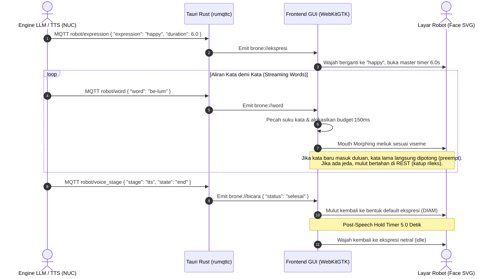

# Spesifikasi Desain: Streaming Word-by-Word Viseme & Kalibrasi Empiris

Dokumen ini adalah **spesifikasi teknis implementasi** integrasi sinkronisasi gerak bibir (*viseme*) berbasis *Streaming Word-by-Word Preemption* antara **Engine LLM/TTS (Intel NUC)** dan **BroneGUI-Tauri (Jetson Orin Nano)**.

Dokumen ini ditujukan sebagai panduan teknis langsung bagi developer yang akan mengimplementasikan modul di sisi GUI maupun LLM.

---

## 1. Arsitektur Komunikasi & Topik MQTT

Sistem menggunakan 2 tahap komunikasi:
1. **Set Ekspresi & Durasi Total (Awal Kalimat):** Menentukan bentuk mata, overlay emosi, dan batas waktu master.
2. **Streaming Kata (Saat Audio Dimainkan):** Mengalirkan teks kata demi kata secara real-time.

### A. Topik MQTT

| Topik | Frekuensi | Contoh Payload | Keterangan |
|---|---|---|---|
| **`robot/expression`** | 1x di awal kalimat | `{"expression": "happy", "duration": 6.0}` | Mengeset emosi dan batas waktu audio total. |
| **`robot/word`** | Per kata (saat audio kata dimainkan) | `{"word": "belum"}` | Memicu animasi bibir kata tersebut secara langsung. |
| **`robot/voice_stage`** | 1x di akhir kalimat | `{"stage": "tts", "state": "end"}` | Penanda selesai audio untuk menutup mulut ke `DIAM`. |

### B. Diagram Alur Sistem (Sequence Diagram)



---

## 2. Validasi Data Empiris (10 Sampel Suara TTS UB)

Konstanta waktu gerak suku kata dihitung secara matematis dari **10 sampel riil keluaran suara Text-to-Speech (TTS) UB**:

| No | Sampel Teks Percakapan | Durasi Total ($t$) | Jumlah Suku Kata ($S$) | Rata-rata per Suku Kata ($\Delta t$) | Kecepatan Bicara ($S/t$) |
|:--:|---|:--:|:--:|:--:|:--:|
| **1** | *"saat ini belum ada informasinya..."* | 6 s | 32 | **0.187 s** (187.5 ms) | 5.33 syl/s |
| **2** | *"FIA berawal dari fakultas administrasi..."* | 24 s | 155 | **0.155 s** (154.8 ms) | 6.46 syl/s |
| **3** | *"perpustakaan pusat UB terakreditasi A..."* | 13 s | 78 | **0.167 s** (166.7 ms) | 6.00 syl/s |
| **4** | *"di UB ada kantor cabang bank BCA..."* | 6 s | 31 | **0.193 s** (193.5 ms) | 5.17 syl/s |
| **5** | *"Sejak dua Mei dua ribu dua puluh enam..."* | 24 s | 148 | **0.162 s** (162.2 ms) | 6.17 syl/s |
| **6** | *"kantor rektor berada di gedung rektorat..."* | 3 s | 19 | **0.158 s** (157.9 ms) | 6.33 syl/s |
| **7** | *"dekan fakultas kedokteran hewan adalah..."* | 7 s | 51 | **0.137 s** (137.3 ms) | 7.29 syl/s |
| **8** | *"kampus dieng UB berada di jalan puncak..."* | 9 s | 58 | **0.155 s** (155.2 ms) | 6.44 syl/s |
| **9** | *"UB menyediakan beasiswa dari pemerintah..."* | 11 s | 72 | **0.153 s** (152.8 ms) | 6.55 syl/s |
| **10** | *"dies natalis UB diperingati setiap lima..."* | 12 s | 86 | **0.140 s** (139.5 ms) | 7.17 syl/s |
| **Σ** | **Total Pengujian Keseluruhan** | **115 s** | **730** | **0.1575 s (157.5 ms)** | **6.35 syl/s** |

### Perhitungan Rata-rata Tertimbang (*Weighted Mean*):
$$\bar{t}_{\text{suku kata}} = \frac{\sum \text{Durasi Total}}{\sum \text{Suku Kata}} = \frac{115\text{ detik}}{730\text{ suku kata}} \approx \mathbf{0.1575\text{ detik}}\ (\mathbf{157.5\text{ ms}})$$

👉 **Konstanta Emas Desain:** Ditetapkan **`150 ms` per suku kata** sebagai basis acuan waktu animasi.

---

## 3. Algoritma Pemecah Kata & Pemetaan Fonetik (GUI)

Ketika sebuah string kata diterima via payload `robot/word`, fungsi pemecah kata menjalankan 4 tahap logika:

### Tahap 1: Pembersihan Tanda Baca
Pisahkan tanda baca penutup (`,`, `.`, `!`, `?`):
* Jika kata mengandung tanda baca jeda (koma `,` atau titik `.`), jadwalkan jeda katup nafas `REST` selama **`150 – 200 ms`** setelah kata selesai.

---

### Tahap 2: Deteksi Akronim / Singkatan (All-Caps Spell-Out)
Jika kata terdiri dari **2 – 5 huruf dan semuanya huruf kapital** (misal: `"BCA"`, `"UB"`, `"ATM"`, `"FIA"`), kata dieja per-huruf dengan kamus abjad Indonesia:

| Huruf | Bunyi Ejaan | Viseme & Alokasi Waktu (Budget 150 ms per huruf) |
|:--:|:--:|---|
| **`A`** | *"a"* | **`A`** (150 ms) |
| **`B`** | *"be"* | **`REST`** (45 ms) $\rightarrow$ **`E`** (105 ms) |
| **`C`** | *"ce"* | **`E`** (150 ms) |
| **`D`** | *"de"* | **`E`** (150 ms) |
| **`E`** | *"e"* | **`E`** (150 ms) |
| **`F`** | *"ef"* | **`E`** (150 ms) |
| **`G`** | *"ge"* | **`E`** (150 ms) |
| **`H`** | *"ha"* | **`A`** (150 ms) |
| **`I`** | *"i"* | **`I`** (150 ms) |
| **`J`** | *"je"* | **`E`** (150 ms) |
| **`K`** | *"ka"* | **`A`** (150 ms) |
| **`L`** | *"el"* | **`E`** (150 ms) |
| **`M`** | *"em"* | **`E`** (105 ms) $\rightarrow$ **`REST`** (45 ms) |
| **`N`** | *"en"* | **`E`** (150 ms) |
| **`O`** | *"o"* | **`O`** (150 ms) |
| **`P`** | *"pe"* | **`REST`** (45 ms) $\rightarrow$ **`E`** (105 ms) |
| **`Q`** | *"ki"* | **`I`** (150 ms) |
| **`R`** | *"er"* | **`E`** (150 ms) |
| **`S`** | *"es"* | **`E`** (150 ms) |
| **`T`** | *"te"* | **`E`** (150 ms) |
| **`U`** | *"u"* | **`U`** (150 ms) |
| **`V`** | *"fe"* | **`E`** (150 ms) |
| **`W`** | *"we"* | **`E`** (150 ms) |
| **`X`** | *"eks"* | **`E`** (150 ms) |
| **`Y`** | *"ye"* | **`E`** (150 ms) |
| **`Z`** | *"zet"* | **`E`** (150 ms) |

*Contoh Eksekusi `"BCA"`:*
* `B` (REST 45ms $\rightarrow$ E 105ms) + `C` (E 150ms) + `A` (A 150ms) = **Total 450 ms (3 suku kata)**.

---

### Tahap 3: Pemecahan Suku Kata Kata Biasa & Budget Sharing (150 ms)
Untuk kata reguler, suku kata dihitung berdasarkan huruf vokal (`a, i, u, e, o`). Setiap 1 suku kata memiliki jatah budget **150 ms**:

1. **Suku Kata Biasa (Non-Bilabial, misal *"sa"* atau *"da"*):**
   * Vokal langsung mendapat **`150 ms`** penuh.
2. **Suku Kata dengan Konsonan Bilabial Onset (`P, B, M` di awal, misal *"be"*):**
   * `REST` (katup bibir merapat kilat) $\rightarrow$ **`45 ms`**
   * Vokal `E` (bibir membuka) $\rightarrow$ **`105 ms`**
   * *(Total = 150 ms)*
3. **Suku Kata dengan Konsonan Bilabial Koda (`P, B, M` di akhir, misal *"lum"*):**
   * Vokal `U` (bibir membulat) $\rightarrow$ **`105 ms`**
   * `REST` (katup bibir penutup M) $\rightarrow$ **`45 ms`**
   * *(Total = 150 ms)*

#### Simulasi Riil Kata *"Be-lum"* (Total 2 Suku Kata = 300 ms):
* Suku kata 1 (*"be"*): `REST` (45 ms) $\rightarrow$ `E` (105 ms) = 150 ms
* Suku kata 2 (*"lum"*): `U` (105 ms) $\rightarrow$ `REST` (45 ms) = 150 ms
* **Total waktu kata tepat 300 ms.**

---

### Tahap 4: Penanganan Kasus Suku Kata Khusus
1. **Vokal Panjang di Akhir Kata (*"Haloo"*, *"Iyaaa"*):**
   * Pertahankan bentuk vokal tersebut lebih lama: $+100\text{ ms}$ per vokal ekstra (misal *"Haloo"* = `A` 150ms + `O` 250ms = 400ms).
   * Bentuk mulut tetap stabil di `O` tanpa menimbulkan *glitch* buka-tutup.
2. **Vokal Kembar Berurutan (*"Sa-at"*, *"Ma-af"*):**
   * **Tidak menggunakan jeda glottal / micro-REST palsu** agar visual tidak kejang/kedut (*anti-twitching*).
   * Mulut tetap tenang di posisi `A` selama total durasi 2 suku kata ($2 \times 150\text{ ms} = \mathbf{300\text{ ms}}$).

---

## 4. Mekanisme State & Preemption Runtime (Execution Engine)

1. **Preemption Instan (Kata Baru Memotong Kata Lama):**
   * Jika kata baru tiba saat kata sebelumnya masih beranimasi, timer kata sebelumnya **langsung dibatalkan**.
   * Animasi kata baru langsung dimulai secara mulus berkat modul *Mouth Morphing* vektor SVG.
2. **Jeda Antar-Kata & Jitter Buffer Jaringan:**
   * Jika kata lama sudah selesai tetapi kata berikutnya belum tiba (akibat jeda nafas atau latensi transmisi), mulut **otomatis bertahan di posisi `REST` (katup rileks)**.
   * **Robot tidak akan pernah "mangap melongo"** saat jeda menunggu kata berikutnya.
3. **Penyelesaian Bicara & Post-Speech Hold:**
   * Saat sinyal `robot/voice_stage` (`tts: end`) diterima atau durasi total tercapai:
     * Mulut kembali ke bentuk default ekspresi aktif (**`DIAM`**).
     * Memulai countdown **Hold 5 detik (`5000 ms`)**.
     * Setelah 5 detik penuh tanpa interupsi, ekspresi kembali ke **`idle`**.

---

## 5. Referensi Implementasi JavaScript (Siap Pakai)

Developer dapat menyematkan fungsi pemecah kata berikut ke dalam `src/js/`:

```javascript
const VOWELS = new Set(['a', 'i', 'u', 'e', 'o']);
const BILABIALS = new Set(['p', 'b', 'm']);

const ACRONYM_MAP = {
  A: [{ v: 'A', durasi: 150 }],
  B: [{ v: 'REST', durasi: 45 }, { v: 'E', durasi: 105 }],
  C: [{ v: 'E', durasi: 150 }],
  D: [{ v: 'E', durasi: 150 }],
  E: [{ v: 'E', durasi: 150 }],
  F: [{ v: 'E', durasi: 150 }],
  G: [{ v: 'E', durasi: 150 }],
  H: [{ v: 'A', durasi: 150 }],
  I: [{ v: 'I', durasi: 150 }],
  J: [{ v: 'E', durasi: 150 }],
  K: [{ v: 'A', durasi: 150 }],
  L: [{ v: 'E', durasi: 150 }],
  M: [{ v: 'E', durasi: 105 }, { v: 'REST', durasi: 45 }],
  N: [{ v: 'E', durasi: 150 }],
  O: [{ v: 'O', durasi: 150 }],
  P: [{ v: 'REST', durasi: 45 }, { v: 'E', durasi: 105 }],
  Q: [{ v: 'I', durasi: 150 }],
  R: [{ v: 'E', durasi: 150 }],
  S: [{ v: 'E', durasi: 150 }],
  T: [{ v: 'E', durasi: 150 }],
  U: [{ v: 'U', durasi: 150 }],
  V: [{ v: 'E', durasi: 150 }],
  W: [{ v: 'E', durasi: 150 }],
  X: [{ v: 'E', durasi: 150 }],
  Y: [{ v: 'E', durasi: 150 }],
  Z: [{ v: 'E', durasi: 150 }],
};

export function parseWordToVisemes(rawWord) {
  if (!rawWord || typeof rawWord !== 'string') return [];

  // 1. Cek tanda baca di akhir kata
  const cleanWord = rawWord.replace(/[,.!?;:]/g, '').trim();
  const hasPause = /[,.!?;:]$/.test(rawWord.trim());

  // 2. Deteksi akronim (2-5 huruf kapital penuh, misal: "BCA", "UB")
  if (/^[A-Z]{2,5}$/.test(cleanWord)) {
    const list = [];
    for (const char of cleanWord) {
      if (ACRONYM_MAP[char]) {
        list.push(...ACRONYM_MAP[char]);
      }
    }
    if (hasPause) list.push({ v: 'REST', durasi: 180 });
    return list;
  }

  // 3. Kata reguler (huruf kecil)
  const lower = cleanWord.toLowerCase();
  const visemes = [];
  let i = 0;

  while (i < lower.length) {
    const char = lower[i];

    // Cek konsonan bilabial awal suku kata (P, B, M)
    if (BILABIALS.has(char)) {
      visemes.push({ v: 'REST', durasi: 45 });
      i++;
      continue;
    }

    // Cek huruf vokal
    if (VOWELS.has(char)) {
      const vokalKey = char.toUpperCase();

      // Cek vokal panjang berulang (misal "oo" di "haloo")
      let extra = 0;
      while (i + 1 < lower.length && lower[i + 1] === char) {
        extra += 100;
        i++;
      }

      // Jika sebelumnya ada konsonan bilabial, porsi vokal adalah 105ms
      const durasiVokal = (visemes.length > 0 && visemes[visemes.length - 1].v === 'REST')
        ? 105 + extra
        : 150 + extra;

      visemes.push({ v: vokalKey, durasi: durasiVokal });
      i++;
      continue;
    }

    // Cek konsonan bilabial penutup koda di ujung kata (misal "m" di "belum")
    if ((i === lower.length - 1 || !VOWELS.has(lower[i + 1])) && BILABIALS.has(char)) {
      visemes.push({ v: 'REST', durasi: 45 });
    }

    i++;
  }

  // Tambahkan jeda nafas jika ada koma/titik
  if (hasPause) {
    visemes.push({ v: 'REST', durasi: 180 });
  }

  return visemes;
}
```
