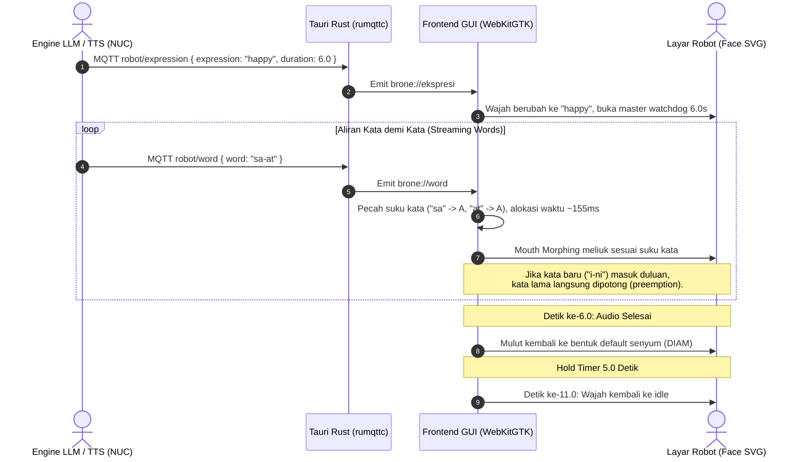

# Rekapitulasi Desain: Streaming Word-by-Word Viseme & Kalibrasi Empiris

Dokumen ini merangkum rancangan arsitektur integrasi sinkronisasi gerak bibir (*viseme*) terkini antara **Engine LLM/TTS (Intel NUC)** dan **BroneGUI-Tauri (Jetson Orin Nano)**, lengkap dengan data uji empiris kecepatan suara TTS robot.

---

## 1. Arsitektur Ide Baru: *Streaming Word-by-Word Preemption*

### A. Latar Belakang Masalah
* **Kendala Sebelumnya:** Mengirim seluruh jadwal timestamp viseme di muka menuntut tim LLM/TTS menghitung fonetik mikro-detik yang kompleks, serta rentan desinkronisasi jika ada jeda jaringan.
* **Solusi Baru:** Pemindahan komputasi fonetik ke sisi GUI. LLM/TTS cukup mengirimkan **status ekspresi di awal**, lalu mengalirkan **kata demi kata secara bertahap (*word stream*)** saat audio dimainkan.

### B. Alur Kerja Sistem (Pipeline)

---

## 2. Validasi Data Empiris (10 Sampel Suara TTS UB)

Penetapan durasi gerak suku kata **bukan berbasis perkiraan fiktif**, melainkan hasil analisis matematis langsung terhadap 10 sampel keluaran audio Text-to-Speech (TTS) asli robot:

| No | Sampel Teks Percakapan | Durasi Total ($t$) | Jumlah Suku Kata ($S$) | Rata-rata per Suku Kata ($\Delta t$) | Kecepatan Bicara ($S/t$) |
|:--:|---|:--:|:--:|:--:|:--:|
| **1** | *"saat ini belum ada informasinya..."* | 6 s | 32 | **0.187 s** (187.5 ms) | 5.33 syl/s |
| **2** | *"FIA berawal dari fakultas administrasi..."* | 24 s | 155 | **0.155 s** (154.8 ms) | 6.46 syl/s |
| **3** | *"perpustakaan pusat UB terakreditasi A..."* | 13 s | 78 | **0.167 s** (166.7 ms) | 6.00 syl/s |
| **4** | *"di UB ada kantor cabang bank BCA..."* | 6 s | 31 | **0.193 s** (193.5 ms) | 5.17 syl/s |
| **5** | *"Sejak dua Mei dua ribu dua puluh enam..."* | 24 s | 148 | **0.162 s** (162.2 ms) | 6.17 syl/s |
| **6** | *"kantor rektor berada di gedung rektorat..."* | 3 s | 19 | **0.158 s** (157.9 ms) | 6.33 syl/s |
| **7** | *"dekan fakultas kedokteran hewan adalah..."* | 7 s | 51 | **0.137 s** (137.3 ms) | 7.29 syl/s |
| **8** | *"kampus dieng UB berada di jalan puncak..."* | 9 s | 58 | **0.155 s** (155.2 ms) | 6.44 syl/s |
| **9** | *"UB menyediakan beasiswa dari pemerintah..."* | 11 s | 72 | **0.153 s** (152.8 ms) | 6.55 syl/s |
| **10** | *"dies natalis UB diperingati setiap lima..."* | 12 s | 86 | **0.140 s** (139.5 ms) | 7.17 syl/s |
| **Σ** | **Total Pengujian Keseluruhan** | **115 s** | **730** | **0.1575 s (157.5 ms)** | **6.35 syl/s** |

### Perhitungan Rata-rata Tertimbang (*Weighted Mean*):
$$\bar{t}_{\text{suku kata}} = \frac{\sum \text{Durasi Total}}{\sum \text{Suku Kata}} = \frac{115\text{ detik}}{730\text{ suku kata}} \approx \mathbf{0.1575\text{ detik}}\ (\mathbf{157.5\text{ ms}})$$

---

## 3. Parameter Desain Algoritma GUI

Berdasarkan data empiris di atas, konstanta waktu yang diadopsi ke sistem frontend adalah:

| Parameter | Nilai Konfigurasi | Keterangan |
|---|:--:|---|
| **Durasi Standar Suku Kata** | **`150 – 160 ms`** | Waktu dasar per suku kata (misal: kata 2 suku kata = 300–320 ms). |
| **Vokal Terbuka Akhir Kata** | **`180 – 200 ms`** | Diberikan sedikit bobot lebih panjang untuk huruf `A`, `O` di ujung kata. |
| **Jeda Tanda Baca (Koma/Titik)** | **`150 – 200 ms`** | Mulut beralih ke `REST` (katup rileks) untuk simulasi jeda nafas alami. |
| **Inter-Word Cutoff (Preemption)** | **`Instant`** | Jika kata berikutnya tiba sebelum durasi kata lama selesai, langsung transisi via *Mouth Morphing*. |
| **Post-Speech Emotion Hold** | **`5000 ms`** | Menahan ekspresi penuh selama 5 detik setelah bicara tuntas sebelum kembali ke `idle`. |

---

## 4. Keunggulan Teknis untuk Presentasi Progress

1. **Efisiensi Beban Tim LLM:** Tim LLM terbebas dari perhitungan timestamp level mikro-detik; cukup streaming teks per-kata.
2. **Eliminasi Network Desync:** Jitter jaringan tidak membuat animasi mulut tertinggal karena setiap kata memicu animasi lokal independen dengan preemption adaptif.
3. **Data-Driven Engineering:** Seluruh konstanta durasi viseme divalidasi secara matematis melalui pengujian 730 suku kata suara asli robot.
4. **Resiliensi Visual:** Didukung *Vector Mouth Morphing* (kontur bibir meliuk elastis) dan *Post-Speech Hold* 5 detik untuk transisi ekspresi yang humanis.
